  

Hi, I'm Andriy, an engineering student (M.A.I.) at Trinity College Dublin. I like building things that people need, across mechanical systems, electronics and software.

- **Formula Trinity:** Mechatronics Engineer in the Autonomous department, working on the systems that let our car drive itself, including the autonomous shifter and emergency braking.
- **Eng Exams:** I built and run [a past-paper index for Trinity Engineering](https://eng-exams.vercel.app), with search, progress tracking and optional accounts that sync across devices. [Write-up](https://www.andriykrav.com/projects/eng-exams).
- Outside engineering: 2× European Championship medallist in lifesaving.

**Find me:** [Portfolio](https://www.andriykrav.com) · [LinkedIn](https://www.linkedin.com/in/andriy-kravchenko-b5b0ba354) · [CV](https://www.andriykrav.com/cv/Andriy_Kravchenko_CV.pdf)
